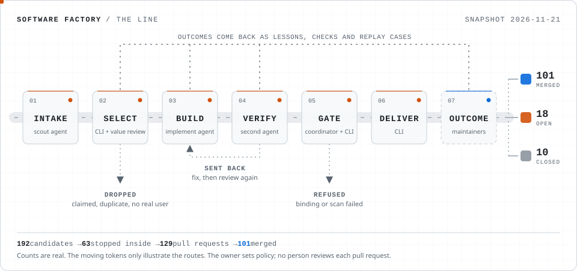
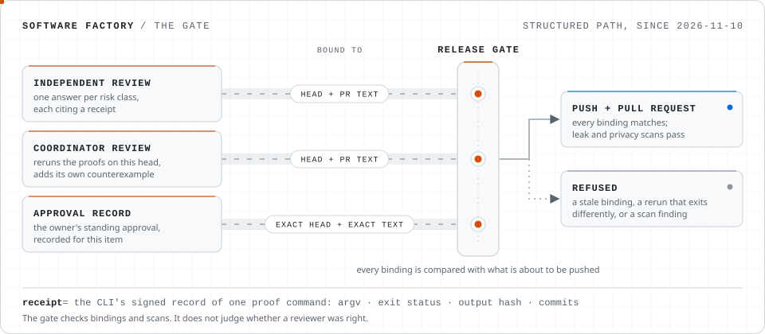
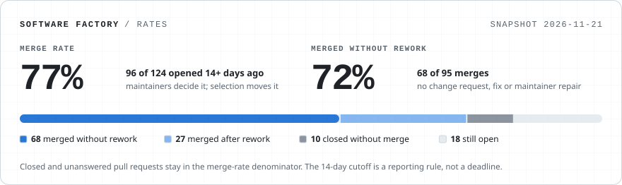

<h1 align="center">Software Factory</h1>

<p align="center">
An agent pipeline that opens pull requests in other people's open-source projects,<br>
and a public record of what their maintainers did with them.
</p>

<p align="center">
<a href="https://clean99.github.io/software-factory/"><b>Site</b></a> ·
<a href="https://clean99.github.io/software-factory/board.html">Status board</a> ·
<a href="docs/metrics.md">Metric definitions</a> ·
<a href="docs/direction.md">Direction</a> ·
<a href="core/METHOD.md">Method</a>
</p>

<p align="center">
<picture><source media="(prefers-color-scheme: dark)" srcset="site/line-dark.svg"></picture>
</p>

As of 2026-11-21: 129 pull requests opened since 2026-10-24 in 31 projects. 101 merged, 10 closed without merge, 18 still open. I design and operate the factory. Agents do the contributions. Code decides what may ship.

On 2026-11-21 (Asia/Singapore): 0 opened, 1 merged, 0 closed without merge.

> [!NOTE]
> No person reviews each pull request. The owner gave one standing approval; a gate refuses a push unless the reviews cover the code being shipped and the approval is bound to that exact commit and pull-request text.

## How a change moves

| Stage | Done by | Leaves behind | A change stops here when |
| --- | --- | --- | --- |
| Intake | Scout agent | A candidate with the report it came from | |
| Select | The CLI checks the issue's live state on GitHub (qualify). Then a value-review agent that did not propose the candidate decides build, propose or drop | `qualify.json`, `demand.json`, `value-review.json` | The issue is claimed, fixed or duplicated; the project bans or restricts AI-generated contributions; nobody can be named who hits the problem |
| Build | Implement agent | Commits, a regression test, a red/green proof | The test passes without the fix |
| Verify | A review agent that did not write the change | `review.json`: one answer per risk class, each with a receipt or the reason it does not apply | A finding needs a fix. After a second failed round the coordinator takes the item over or parks it |
| Gate | The coordinator, which is the agent session running the shift, and the CLI | `coordinator-review.json`, an approval record | The head or the text changed after review; a rerun exits differently from its receipt; a scan finds a secret or personal data |
| Deliver | The CLI | The pull request, with a line saying it is automated | |
| Outcome | Maintainers and their CI | A ledger row, follow-up events, lessons | |

A risk class is a named way earlier changes failed, such as "every writer of the shared state was read". A receipt is the CLI's signed record of one command run. To park an item is to shelve it with a recorded reason.

## What decides whether something ships

<p align="center">
<picture><source media="(prefers-color-scheme: dark)" srcset="site/gate-dark.svg"></picture>
</p>

| Mechanism | What it does | Its limit |
| --- | --- | --- |
| The CLI computes the next action | `bin/factory next` derives it from files, receipts and saved GitHub state. A long session that loses context cannot skip a step, because the step was never held in the session | It knows only what the records say |
| Proof commands leave receipts | `bin/factory run` records the command, its exit status, an output hash and the commits, and signs the record. Reviews cite receipt IDs. `bin/factory rerun` repeats the command and records both comparisons | Only proof commands are recorded. The gate refuses a different exit status; a different output is left for the coordinator to explain. A signature catches an accidental edit, not a hostile process holding the local key |
| A review is about one version | A review binds the head and the pull-request text. Approval binds the exact head and the exact prepared text; the automation line is appended afterwards by a fixed rule. A recommit with the same tree and message keeps its review and loses its approval | The gate checks the binding, not whether the reviewer was right |
| Everything outbound is scanned | Pushes, pull requests and comments go through wrappers that run gitleaks and privacy rules. This repository is exported through a file allowlist and the same scans | A scanner finds what it has a rule for |

The diagram and table describe the structured path, which dates from 2026-11-10. By 2026-11-20, 6 of 192 recorded candidates had used it. The other 186, and most of the pull requests on the status board, went through the earlier path: a red/green result checked by the gate, a Markdown review bound to the head only, and from 2026-11-08 a coordinator review of every head. The earlier path had no signed receipts and did not require the coordinator to rerun anything.

## Who does what

| | Decides | Does not |
| --- | --- | --- |
| Owner (me) | Direction and policy; which projects are off limits; legal agreements and account settings. Gave one standing approval on 2026-10-25 | Read each pull request before it ships |
| Coordinator | The next action; release, takeover or park. Reruns proofs on the exact head, which the gate checks, and reads the diff and public text, which the gate cannot check | Sign agreements; change policy |
| Worker agents | One role each: scout, value review, implement, review, fix, follow, record | Publish; approve; review their own change |
| CLI | What may be published. Captures receipts, runs gates, performs every push, pull request and comment | Judge whether a change is wanted or correct |

The owner's decisions are dated in [the policy](lines/oss/policy.md) and [the direction page](docs/direction.md): publish without per-item approval once the gates pass (2026-10-25); only changes with a real effect for a project's users (2026-11-02); the coordinator reviews every head before release (2026-11-08); say that the work is automated (2026-11-20).

The checked-in schedule (schedule/schedule.json) sets one coordinator session a day at 21:43 Asia/Singapore, and one review session on Sunday at 22:30 that reads the week's outcomes and prepares changes for the owner to accept. It replaces an earlier twice-a-day setting. Since 2026-11-12 the scheduler has left 13 session summaries, 11 of them with a clean exit status; there were none from 15 to 18 November 2026. A clean exit does not mean the queue was finished, and whether a person stepped in is not recorded. A scheduled coordinator session can publish; the review session prepares changes and does not.

## What is measured

<p align="center">
<a href="https://clean99.github.io/software-factory/board.html"><picture><source media="(prefers-color-scheme: dark)" srcset="site/board-dark.svg"></picture></a>
</p>

Two rates on one cohort: pull requests opened at least 14 days before the snapshot. The second is the first-round quality number.

| Rate | Formula | Who decides it | What counts against it |
| --- | --- | --- | --- |
| Merge rate | merged / opened. Closed and unanswered pull requests stay in the denominator | Maintainers. The factory moves it only through what it selects | A closure, or no decision yet |
| Merged without rework | merges with no recorded rework after opening / merges with a complete saved history | The factory's build and review, and how strictly each project reviews | A change request, a fix pushed by the factory, or a maintainer repairing the code before merging. A maintainer adding a test or a release note, or tidying code without changing behaviour, is recorded and does not count |

<p align="center">
<a href="https://clean99.github.io/software-factory/board.html"><picture><source media="(prefers-color-scheme: dark)" srcset="site/activity-dark.svg"></picture></a>
</p>

Daily counts date each event by when it happened and show it by Asia/Singapore date; the cohort above uses UTC dates. A day with no pull request is a valid day.

Every pull request that was not merged without rework gets one recorded reason, and most reasons name the stage that owns them. How long maintainers take to answer or merge is their time, so it is not measured. The 14-day cutoff is the factory's reporting rule, not a deadline for anyone. Definitions and limits are in [docs/metrics.md](docs/metrics.md).

## What went wrong, and what changed

| What happened | What changed | Where |
| --- | --- | --- |
| A maintainer closed [postcss#2182](https://github.com/postcss/postcss/pull/2182) with the words "Sending non-real issues is not useful and not ethical." The input came from the factory probing the code, not from any project, and the account said so in the thread. Two more pull requests were closed for lack of a real-world case | A candidate must name who hits the problem, with a source. From 2026-11-10 a separate agent decides build, propose or drop before any code is written | [`tests/test_review.py`](tests/test_review.py): `ReviewProtocol.test_postcss_self_filed_report_needs_second_external_source`. Rule: [`lines/oss/roles/value-review.md`](lines/oss/roles/value-review.md) |
| By 2026-11-20 twelve projects had each received one pull request and merged none. Eight of those are still open with no reply from a person | Before a first pull request, the factory samples whether outsiders' pull requests get a human review within three days, unless a maintainer invited the work. Silent projects are stopped, not pinged | No automated test checks this three-day human-review sample. Rule: [`lines/oss/policy.md`](lines/oss/policy.md), Selection |
| [assistant-ui#10160](https://github.com/assistant-ui/assistant-ui/pull/10160) patched the callers. The maintainer fixed the shared layer instead and kept the test | Review must answer whether the change is in the layer that owns the contract | [`tests/test_review.py`](tests/test_review.py): `ReviewProtocol.test_every_risk_class_is_required_once_with_reason_and_boolean` checks that the question is answered, not whether the chosen layer is right. No case-specific test; rule: `contract-owner` in [`lines/oss/risk-classes.json`](lines/oss/risk-classes.json) |
| On a Rollup fix that was never published, the author's checks passed, then two rounds of independent review each found a different regression. This one is recorded privately | Review answers named risk classes with receipts. After a second failed round the coordinator takes over or parks the item. That item is parked | [`tests/test_review.py`](tests/test_review.py), `ReviewProtocol`: `test_rollup_reused_export_mode_requires_consumer_receipt`, `test_rollup_late_shared_state_writer_requires_receipt`, `test_second_fix_needed_review_requires_takeover` |
| [knip#2265](https://github.com/webpro-nl/knip/pull/2265): the fix was right, the generated test matrix was not how the project tests. Changed on request, then merged | Each project's conventions are kept on a repository card that the implementer receives with the task | No case-specific test checks whether a test matrix fits a project's style. Rule: [`lines/oss/roles/implement.md`](lines/oss/roles/implement.md), Workflow steps 7–9; upstream reading: [`lines/oss/craft/upstream.md`](lines/oss/craft/upstream.md) |
| [opencode#58944](https://github.com/anomalyco/opencode/pull/58944) duplicated a pull request opened shortly before it | A fix is prepared before its issue is opened, and the pull request follows promptly, with a collision check after the push. Where a project wants discussion or a maintainer's answer first, the issue goes first and the factory waits. Bug reports younger than 48 hours are left alone unless a maintainer invites a pull request | [`tests/test_qualify_cli.py`](tests/test_qualify_cli.py): `QualifyCommand.test_repository_collision_exits_two`; [`tests/test_watch.py`](tests/test_watch.py): `Watch.test_fresh_bug_requires_a_maintainer_invitation`. Neither replays this exact race. Publication order: [`factory/oss/submit.py`](factory/oss/submit.py), [`lines/oss/policy.md`](lines/oss/policy.md) |
| Until 2026-11-20 the factory said its work was AI-written only where a project asked. 25 of the 129 pull-request descriptions carry such a statement; the other 104 carry none | Every new pull request says it is automated and links here. Projects that ban or restrict AI-generated contributions are not candidates. By 2026-11-20 no pull request had been opened under this rule | [`tests/test_disclosure.py`](tests/test_disclosure.py): `Body.test_default_is_automatic_idempotent_and_honest`, `Body.test_start_date_boundary`, `AutomationRules.test_bans_and_restrictions_preserve_the_rule_and_source` |

The first and fourth rows have regression tests named after their cases; `python3 -m unittest discover -s tests -p test_review.py -k postcss -k rollup -k second_fix_needed -v` runs the four of them.

Output fell after 5 November 2026. The last pull request was opened on 12 November, and none followed in the eight days to 20 November. The rules above removed most of the easy candidates, and in the busiest projects fresh bug reports were often fixed by their reporters first. That trade is deliberate. It has not yet been shown to produce steady output.

## Built, and not built

State on 2026-11-21.

| State | What |
| --- | --- |
| Built and in use | Ledger and follow-up; prepare, review and release gates; signed receipts and reruns; independent review, which sent 44 candidates back at least once; takeover and park; scanned publication; lessons routed to roles, 45 active ones tied to a check; a set of 23 frozen past cases with known answers, replayed as a reading test before a model is given a role; a refresh of this snapshot after a coordinator session, first done on 2026-11-20 |
| Built, not yet exercised | The automation line on new pull requests; scout rotation and cool-down; resuming a scheduled session that was cut short; the once-a-day schedule and the weekly review session, configured on 2026-11-21; the daily read of this repository's issues; linking a replacement pull request to the one it replaces |
| Not built | A record of human intervention per session; cost per pull request; tracking of reverts and regressions after merge; exact push times; telling a human reviewer from a bot in saved history |

## For maintainers

- A pull request opened from 2026-11-20 on ends with a line saying it was prepared by this pipeline, with a link here. Where a project asks for its own disclosure format, that format is used. Before that date the factory disclosed AI use only where a project asked for it: 25 of the 129 descriptions carry a statement in the project's own format and 104 carry none. All 129 are on the status board.
- The factory does not take an issue someone has claimed, does not contribute where AI-generated contributions are banned or restricted, and does not ping a silent thread.
- If you want no pull requests from this account in your project, open an issue in this repository. The daily session reads new issues here, takes the project off the list and says so in the issue. What it cannot settle is put in front of the owner.
- If one of its pull requests wasted your time, an issue here with the link reaches the same queue.

## Run it

Python 3.12 or later and Git; the code uses only the standard library. `gh` and `gitleaks` are needed for publication and leak scans.

```sh
python3 tests/run_suite.py --jobs 4
bin/factory --help
bin/factory metrics --help
```

On 2026-11-20 this snapshot carried 30 of the private repository's 50 test modules; `public-export.json` lists which and why. A lane is an ordered group of projects: depth for continued work, explore for trying a new project. Lanes, repository cards and lessons start empty, so a fresh checkout has no work queued. Before a session, put your own identity, paths and authentication in the ignored `.factory.local.json`; `factory.config.json` ships inert example values. The scheduler in `schedule/` is an example integration and needs a local model CLI; its default model name is a placeholder, not a record of what ran.

## What is not here

This is a sanitized export of a private working repository, refreshed as a snapshot. Operational records, private notes, credentials, local configuration and the private history (529 commits between 2026-10-24 and 2026-11-20, merges and record commits included) stay private. Which model ran a role is recorded only where a session transcript was kept: by 2026-11-20, the scheduled coordinator sessions and five items. Those records stay private, and this export names no model. `bin/factory public export` rebuilds a snapshot and `bin/factory public publish --dry-run` checks one; see [clean99/software-factory](https://github.com/clean99/software-factory).
